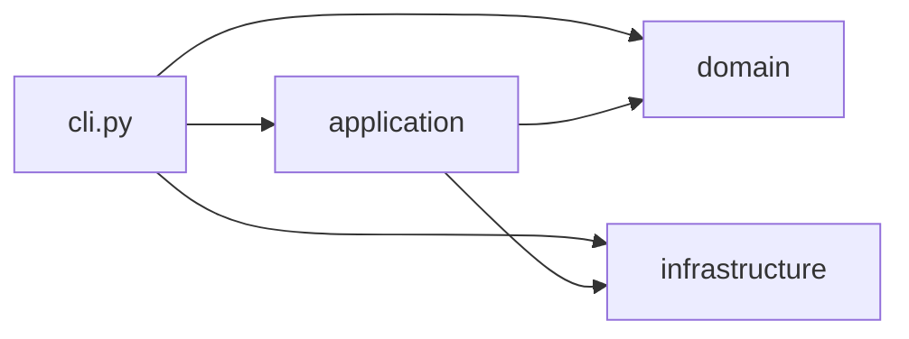

# Arquitectura actual

DigitalBrain usa una estructura por capas ligera. El backend está empaquetado con `BACK/pyproject.toml` y su código vive en `BACK/src/digital_brain/`. La CLI es la interfaz ejecutable disponible hoy. La aplicación C# y WPF todavía no existe.



Las flechas representan importaciones directas entre componentes. La CLI crea el extractor del dominio y usa el capturador de infraestructura, además de llamar a los casos de uso de `application`.

| Componente | Responsabilidad actual |
| --- | --- |
| `domain/signal_features.py` | Valida ventanas de cuatro canales y extrae 16 características espectrales. No lee archivos ni inicia procesos. |
| `application/dataset.py` | Lee capturas por medio de infraestructura, forma ventanas y escribe CSV etiquetados. |
| `application/models.py` | Construye los cinco estimadores y conserva la configuración propia de SVM. |
| `application/training.py` | Carga y valida CSV, divide filas, entrena, evalúa y guarda un modelo. |
| `application/realtime.py` | Carga un modelo y clasifica un iterador de muestras por ventanas. |
| `infrastructure/capture.py` | Interpreta líneas de captura, lee archivos y ejecuta el capturador externo. |
| `cli.py` | Expone `capture`, `build-dataset` y `train`. |

## Flujo disponible

```text
Carpeta externa del programa ──capture──► archivo .txt
                                  │
                                  ▼
                            build-dataset
                                  │
                                  ▼
                            CSV etiquetado ──train──► modelo .pkl

iterador de muestras + modelo .pkl ──► RealtimeClassifier ──► etiquetas
```

`capture` recibe la ruta de una carpeta externa que contiene `ConDump.exe` y sus archivos auxiliares. Ejecuta el programa con esa carpeta como directorio de trabajo y guarda en `BACK/datos_capturados/` por defecto. `build-dataset` recibe explícitamente una carpeta de archivos `.txt`; no hay conexión automática entre ambos pasos. Tampoco hay un comando de inferencia en tiempo real que una el proceso de adquisición con `RealtimeClassifier`.

Los datos originales versionados están en `BACK/datos/`. Las rutas `BACK/artifacts/datasets/` y `BACK/artifacts/models/` son ejemplos de salida: se crean al ejecutar los casos de uso, no son carpetas obligatorias del paquete.

## Límites de la estructura

Esta organización separa el cálculo de señal de los detalles de archivos y procesos. No implementa puertos o interfaces formales entre `application` e `infrastructure`; `dataset.py` importa directamente el lector de capturas y usa Pandas. Por ello se describe como arquitectura por capas ligera, no como una implementación estricta de Clean Architecture.

Las pruebas actuales están en `BACK/tests/` y se ejecutan desde `BACK/` con `python -m unittest discover -s tests -v` dentro del entorno instalado. El formato de datos y las limitaciones de evaluación se detallan en [Datos y modelos](datos-y-modelos.md).
